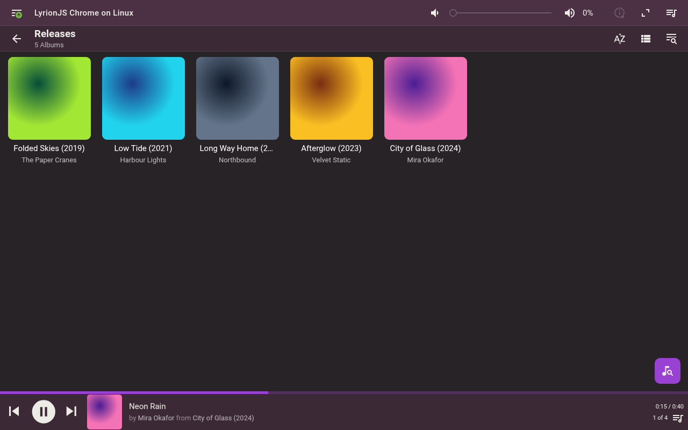
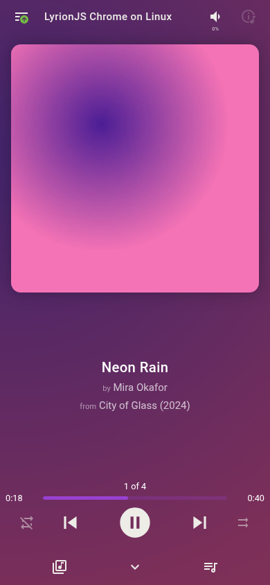
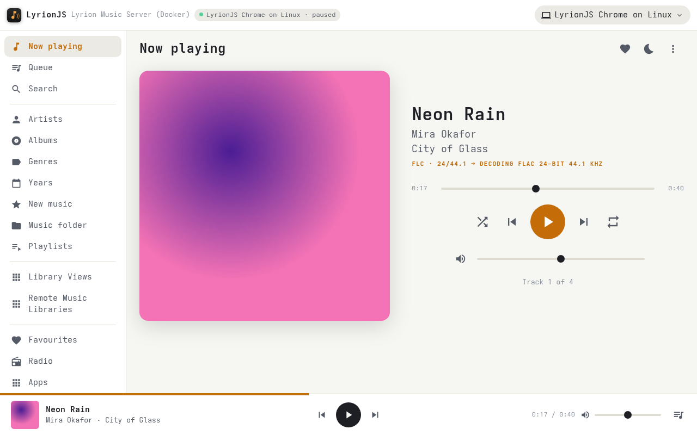
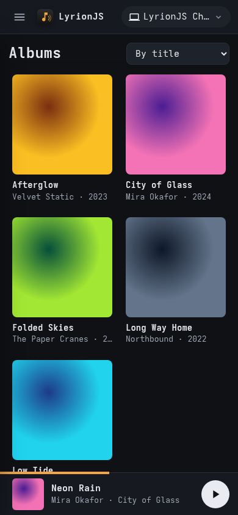
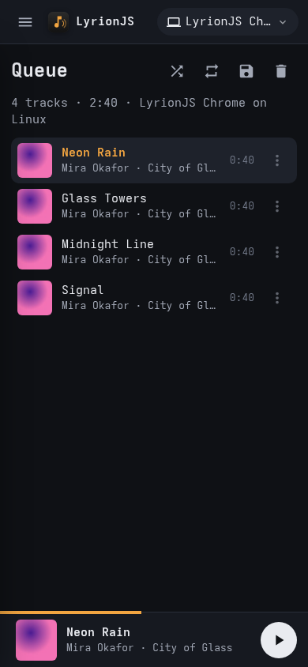
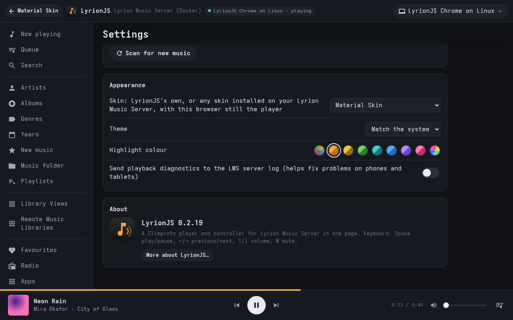

<p align="center">
  
</p>

# LyrionJS

A plugin for [Lyrion Music Server](https://lyrion.org) (LMS) that turns any web browser into a
player. Open the LyrionJS page on a phone, tablet or computer and that browser shows up in LMS
as a player, like a Squeezebox or squeezelite. It plays in sync with your other players and can
control all of them.

It adds a new way to play and changes nothing else about LMS.

### Keep the skin you know

LyrionJS can show **any web skin installed on your LMS**, such as Material Skin, Default or
Classic, with the browser still the player. You get the skin you already use, exactly as LMS
serves it and at whatever version you've installed, and the music plays right there in the
browser. Pick it once in *Settings › Skin*, or with one tap in *My Apps › LyrionJS* (see
[Skins](#skins)).



<p>
  
</p>

### Or its own look



<p>
  
  &nbsp;
  
</p>

## Features

- **Any LMS skin, or its own.** Use Material Skin, Default, Classic or any other web skin
  installed on LMS, with this browser as the player. Or use LyrionJS's own look, or its Material
  layout (with the colour taken from the cover art), in light or dark, with a highlight colour of
  your choice. See [Skins](#skins).
- **A real LMS player in the browser.** It's gapless or crossfades, syncs with your other players, and handles
  volume, power and renaming.
- **Lossless.** FLAC up to 24-bit/192 kHz, WAV/AIFF and MP3 are decoded in the page. LMS converts
  everything else (AAC, Ogg, radio, streaming services) as usual.
- **Phones and tablets.** It keeps playing with the screen locked, and the lock-screen controls work.
- **The whole of LMS.** Library, search, queue, playlists, favourites, radio, apps and plugins,
  players and sync, alarms and sleep timer.
- **In your language.** English, Čeština, Dansk, Deutsch, Español, Français, Italiano, Magyar,
  Nederlands, Norsk (bokmål), Norsk (nynorsk), Polski, Suomi and Svenska. It follows LMS's
  language setting, or choose one for each browser in *Settings › Language*. The translations are
  AI-made: [corrections welcome](#translations).

## Install

1. In LMS, go to *Settings › Plugins*. At the bottom, under *Additional Repositories*, add:

   ```
   https://raw.githubusercontent.com/JameZUK/LyrionJS/main/repo.xml
   ```

2. Click *Apply*. Then tick **LyrionJS** in the list, click *Apply* again, and restart LMS when asked.
3. Open `http://<your-lms>:9000/plugins/LyrionJS/` in any browser. You can also open it from
   *Apps › LyrionJS*, Material Skin's home screen, or *Settings › Plugins › LyrionJS*.
   Tap once so the browser allows sound.
4. Optional: in LyrionJS, choose your usual skin in *Settings › Skin*.

   <sub>Whatever you do, don't open *Apps › LyrionJS* from inside LyrionJS.</sub>

LMS offers updates through the same repository. To install by hand instead, unzip the release zip
into a `LyrionJS` folder in LMS's plugin folder and restart LMS.

**Requirements:** LMS 8 or later and a current browser. iPhone and iPad need iOS 17.1 or later to
keep playing with the screen locked.

## Skins

In LyrionJS, *Settings › Skin* lists two kinds:

- **LyrionJS:** its own look, and *Material*, its own layout in the style of Material Skin.
- **Lyrion Music Server:** every web skin installed on your LMS (Material Skin if you have it,
  Default, Classic, Light…). The server's own choice is marked.



Or skip Settings: *My Apps › LyrionJS* has a second link, named after the skin your server uses
(**Material Skin, with this browser as a player**, for example). Open it in any browser and that
browser opens LyrionJS in that skin from then on. Each browser keeps its own choice, so you pick
which browsers get the skin: one that never opens the link stays as it was.

With an LMS skin chosen, LyrionJS opens straight into that skin. The browser stays the player,
so it plays, keeps going with the screen locked and shows on the lock screen just as with
LyrionJS's own look. Everything else is the skin's own: browsing, the queue, settings and other
players.

**Getting back to LyrionJS.** Inside the skin, click any LyrionJS link: the LyrionJS tile on
Material Skin's home screen, the address in *My Apps › LyrionJS*, or *Extras › LyrionJS*. It
takes you to LyrionJS's own pages (its settings, this player's details) in the same tab, rather
than opening a second player. To return to the skin, use the button at the top named after it
(**← Material Skin**, for example), the one on the About page, or Back. To stop using the skin
in this browser, choose LyrionJS in *Settings › Skin*.

A few things to know:

- Pick Material Skin on phones. Default and Classic are laid out for desktop browsers.
- Some plugins add folders that LMS lists as skins but aren't whole skins (for example Custom
  Browse's *Fishbone* or *iPeng*). They show LMS's plain *Light* pages instead.
- In Material Skin, opening *My Apps › LyrionJS* from its menus shows a short page with
  LyrionJS's address and the skin link. Tap one, or use the home screen tile, which goes
  straight to LyrionJS.

## Settings

*Settings › Plugins › LyrionJS* has these options:

- Whether browsers may connect as players.
- Whether radio is fetched through LMS.
- The default audio output.
- Diagnostics to the LMS log.
- The address LMS links to, for example behind a reverse proxy.

Each browser also has its own settings page inside LyrionJS, including its skin and language.

### Old and deleted players

Each browser is one player and keeps its identity across reloads, restarts and updates (in the
page's storage, with a copy in a cookie). Only a private window or clearing the site's data makes
a new player. A closed page drops out of LMS's player list within seconds.

LMS keeps the settings of every player it has ever seen, even after *Forget player*, and has no
way for a plugin to remove them. LyrionJS doesn't edit LMS's settings, so an old player's
settings (a few KB) stay, as they do for any other player.

### Translations

The translations were made with AI (Claude), not by native speakers. They follow LMS's own wording
where LMS has it, so LyrionJS reads like the rest of LMS, but they haven't been checked by someone
who speaks each language, so some phrases may be awkward or wrong. Corrections are very welcome.

To fix one:

1. Open your language's file in [`src/i18n/`](src/i18n), for example `de.json` for German. Each
   line is the English text, then its translation:

   ```json
   "Add to queue": "Zur Warteschlange hinzufügen",
   ```

2. Change the translation (the right-hand side) only. Keep the English (the left-hand side) as it
   is, and keep anything in braces, such as `{name}` or `{n}`: LyrionJS fills those in. Counted
   text has one entry per plural form (`"one"`, `"other"`, and in some languages `"few"` or
   `"many"`).
3. Send it as a pull request. If you'd rather not edit files, [open an
   issue](https://github.com/JameZUK/LyrionJS/issues) saying which text, the language, and what it
   should say.

To check your change before sending it: `node --test tests/i18n.test.mjs` (it checks that nothing
is missing and every `{placeholder}` is kept). A new language is welcome too: see
[`docs/DEVELOPMENT.md`](docs/DEVELOPMENT.md#languages).

## Limitations

- On iPhone and iPad the device's volume buttons set the volume. LMS's volume for that player
  stays at 100 %.
- Crossfades need both tracks at the same sample rate. Otherwise the tracks play gaplessly, as on
  squeezelite.
- It has no login of its own beyond LMS's optional password. Like LMS, it's meant for your home
  network.

## Licence

GPL-2.0-or-later (see [`LICENSE`](LICENSE)). The project's own code also carries an additional
permission for distribution through app stores, as long as the full source stays available
under the GPL: see [`LICENSE-EXCEPTION`](LICENSE-EXCEPTION).

LyrionJS is an independent project, not an official Lyrion one.

## More

- [How it works, and the protocol](docs/ARCHITECTURE.md)
- [Building, testing and releasing](docs/DEVELOPMENT.md)
